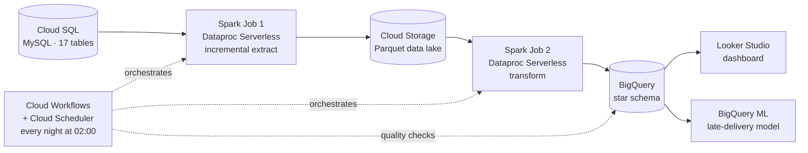
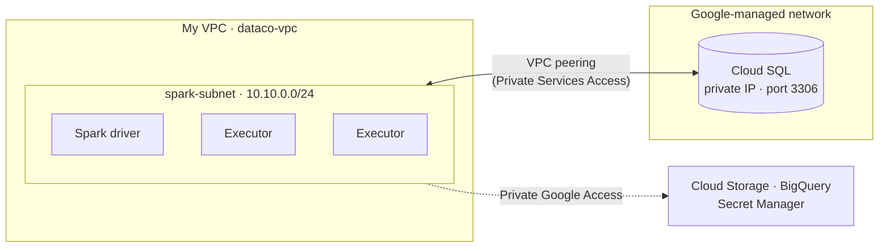
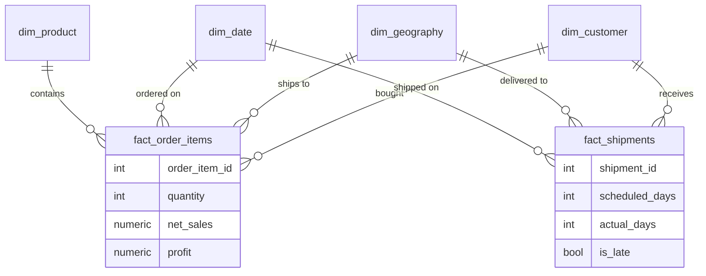

# End-to-End Data Pipeline on Google Cloud

A nightly, fully automated data pipeline on Google Cloud: from a MySQL database to a Parquet data lake, a BigQuery star schema, and a BigQuery ML model.


---

## Overview

The project takes a real, public supply-chain dataset (180,519 order lines, 53 columns, January 2015 to January 2018) and builds everything a data team would need around it:

- a **normalized MySQL database** on Cloud SQL, designed from one flat CSV,
- **serverless Spark jobs** that extract the data incrementally and transform it,
- a **BigQuery warehouse** modeled as a star schema and checked on every load,
- **Machine learning models** trained with SQL in BigQuery ML,
- **nightly automation**, running end to end in about 6.5 minutes.

📊 **Original Dataset from Kaggle:** [Dataco Supplychain for Big Data Analysis](https://www.kaggle.com/datasets/shashwatwork/dataco-smart-supply-chain-for-big-data-analysis)

---

## Architecture



---

## Tech Stack

| Layer | Tools |
|---|---|
| Source database | Cloud SQL (MySQL 8.4) |
| Processing | Apache Spark (PySpark) on Dataproc Serverless |
| Data lake | Cloud Storage, Parquet |
| Warehouse | BigQuery |
| Machine learning | BigQuery ML (logistic regression, boosted trees / XGBoost) |
| Dashboard | Looker Studio |
| Orchestration | Cloud Workflows, Cloud Scheduler |
| Networking and security | VPC, VPC peering (Private Services Access), Private Google Access, IAM, Secret Manager |
| Testing | pytest, SQL assertions in BigQuery |

---

## Highlights

### 🗂️ Data modeling
- One flat 53-column CSV redesigned into **17 linked MySQL tables in third normal form (3NF)**.
- Each table's grain and source columns are documented at the top of its SQL file.
- In BigQuery, a **star schema** with two fact tables at two different grains, so every number is counted exactly once.

### 🌐 Private networking
- Spark runs in a private subnet with **no public IPs** and reaches Cloud SQL over **VPC peering**.
- **Private Google Access** lets the Spark machines reach Cloud Storage, BigQuery and Secret Manager without the internet.
- Cloud SQL's public IP is locked; admin access goes through the **Cloud SQL Auth Proxy**.



### 🔐 Security
- Three **least-privilege service accounts**: one runs Spark, one runs the workflow, one only starts it.
- Roles are granted on the narrowest scope (one bucket, one secret, specific datasets).
- A **read-only MySQL user** for Spark, with its password in **Secret Manager**, never in code.

### ⚡ Serverless Spark
- Two PySpark jobs on **Dataproc Serverless**: no cluster to create or manage, billed per second.
- **Incremental extract:** each run copies only rows with an id higher than the last one already in the lake.
- The transform job rebuilds the warehouse tables on every run, so there are never duplicates.

### 📊 Warehouse and quality
- **SQL data quality checks** (`ASSERT`) run after every load and stop the pipeline if a key is missing or a row is duplicated.
- The dashboard reads only a separate reporting dataset of views, so the warehouse can change without breaking it.



### 🤖 Machine learning with SQL
- **Logistic regression** and **boosted trees (XGBoost)** trained in **BigQuery ML** with plain SQL.
- A **time-based split**: trained on January 2015 to June 2017 and tested on July 2017 to January 2018, months the models never saw.
- Columns that would leak the answer (actual delivery days, delivery status) are excluded, and a test keeps them out.
- Both models are compared against a **simple one-line baseline rule**.

### ⏰ Automation
- **Cloud Workflows** runs the steps in order (extract → transform → quality checks) and stops on any failure.
- **Cloud Scheduler** starts it every night at 02:00.
- A full run takes about **6.5 minutes**.

### 🧪 Testing
- **60 automated tests** with pytest, plus SQL checks in BigQuery and row-count reconciliation against MySQL.

---

## Key Findings

- **57% of delivered shipments arrive late**, and the rate is almost identical in every market.
- **The shipping mode decides lateness:** First Class promises 1 day and always takes 2, so it is late 100% of the time. Second Class is late 80% of the time.
- **Honest ML result:** the best model reached **0.700 accuracy (AUC 0.749)**, while the simple shipping-mode rule reached **0.696**. The data carries one strong signal, and better predictions would need new data such as carrier or weather.

---

## Project Structure

```text
├── schema/        # MySQL table definitions and data load scripts (17 tables, 3NF)
├── pipeline/
│   ├── config.sh          # all names and settings in one place
│   ├── setup/             # step-by-step setup: network, IAM, storage, Cloud SQL, BigQuery
│   ├── jobs/              # PySpark jobs: extract (MySQL → Parquet) and transform (Parquet → BigQuery)
│   ├── bigquery/          # datasets, star schema tables, reporting views, ML SQL
│   ├── ml/                # model training and evaluation script
│   ├── workflow/          # Cloud Workflows definition and deploy script
│   ├── run_pipeline.sh    # run the whole pipeline by hand
│   └── cleanup.sh         # delete every resource when done
└── tests/         # pytest unit tests
```

---

## Getting Started

Everything runs from **Cloud Shell**; nothing needs to be installed locally.

1. Set your project, region and names in `pipeline/config.sh`.
2. Run the setup scripts in `pipeline/setup/` in order (network, IAM, storage, Cloud SQL, BigQuery).
3. Run the pipeline once by hand: `bash run_pipeline.sh`
4. Deploy the nightly workflow: `bash workflow/deploy_workflow.sh`
5. Train and evaluate the models: `bash ml/train_model.sh`
6. When you are finished, remove everything: `bash cleanup.sh`
